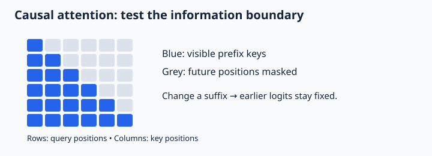

# Lecture 02 — The causal Transformer

[Course home](../../README.md) · Week 1, day 2 · 120 minutes · [Slides](../slides/02_transformers.pptx) · [Notebook](../tutorials/02_transformers.ipynb) · [Exercises](../exercises/02_transformers.md) · [Quiz](../quizzes/02_transformers.md)

## Learning outcomes

- Trace tensor shapes through a decoder block, from token IDs (B, T) to logits (B, T, V).
- Compute masked attention by hand for two tokens, and implement multi-head attention with causal and padding masks.
- Count the parameters of a block from a model's configuration.
- Test a decoder for future-token leaks with the causal-invariance test.

## Session plan

| Minutes | Activity |
|---|---|
| 0–10 | Quiz 1 (language models, tokens and baselines) |
| 10–35 | Slides 1–11: the residual stream, pre-norm, attention; the two-token example on the board; the two masks |
| 35–60 | Slides 12–24: shape tracing, parameter counts, modern variants, RoPE, teacher forcing, the invariance test |
| 60–65 | Break |
| 65–105 | [Notebook 2](../tutorials/02_transformers.ipynb): sections 1–5 together, section 6 in pairs |
| 105–115 | Slide 25: the all-zero-mask question, then the practical questions in pairs |
| 115–120 | Slides 26–28 and the exit ticket: one shape, one bug the test catches and one it misses, your model's width and depth |

## Teaching notes

### The residual stream
Token IDs index an embedding table and give $X\in\mathbb R^{T\times d}$, one row per token. A pre-norm decoder block computes $H=X+\mathrm{Attention}(\mathrm{Norm}(X))$ and then $Y=H+\mathrm{MLP}(\mathrm{Norm}(H))$. After the last block the hidden state is normalised once more and projected to vocabulary logits.

Each sublayer reads a normalised copy of the stream and adds its result back. Attention moves information between positions. The MLP works on each position alone. Because sublayers add and do not overwrite, the stream between two blocks can be read and edited. Day 11 (steering) does that: it finds a direction in this stream, adds to it or removes it, and measures the model's answer.

LayerNorm subtracts the mean of each row and divides by its standard deviation, with a learned gain and bias. RMSNorm divides by the root mean square and does not subtract the mean. The 2017 Transformer normalised after each addition; pre-norm keeps the stream itself unscaled and trains more easily at depth (Xiong et al., 2020).

### Attention is content-dependent mixing
Let $Q=XW_Q$, $K=XW_K$ and $V=XW_V$. Then

$$
A=\operatorname{softmax}\!\left(\frac{QK^\top}{\sqrt{d_k}}+M\right),\qquad O=AV.
$$

The softmax runs along each row, so every row of $A$ sums to one, and row $i$ of $O$ is an average of the value rows weighted by row $i$ of $A$. Subtract each row's maximum before exponentiating.

If the components of a query and a key are independent with mean 0 and variance 1, their dot product has variance $d_k$. Wide heads then produce large scores and a softmax that puts nearly all its weight on one key. Dividing by $\sqrt{d_k}$ returns the variance to 1. In the slide figure, with 16 random keys, the largest unscaled weight rises from 0.43 at width 4 to 0.95 at width 1,024, and the scaled one stays near 0.24.

### Two masks
A causal mask sets every score whose key position is greater than its query position to $-\infty$. A padding mask sets the scores of padding keys to $-\infty$. They do different jobs and a batch needs both: the causal mask has shape (T, T), the padding mask (B, 1, 1, T), and their conjunction broadcasts to (B, 1, T, T). Padded positions must also be left out of the loss.

Apply the mask before the softmax. Zeroing weights after the softmax, without renormalising, leaves rows that sum to less than one, and early rows lose the most.

### Shapes, heads and counts
With B sequences, T tokens, width d and H heads:

| Step | Shape |
|---|---|
| Token IDs | (B, T) |
| Embeddings; $Q$, $K$, $V$ | (B, T, d) |
| Split into heads | (B, H, T, d/H) |
| Scores and weights | (B, H, T, T) |
| Mixed values | (B, H, T, d/H) |
| Merged, times $W_O$; after the MLP | (B, T, d) |
| Logits | (B, T, V) |

Heads are a reshape of the same three projections. Each head has its own attention pattern, and the scale is the head width d/H. Head outputs are concatenated and projected back to width d by $W_O$. The number of heads does not change the parameter count.

One GPT-2 small block (d = 768, MLP width 3,072, biases) has $4d^2+4d=2{,}362{,}368$ attention parameters, $2\cdot d\cdot d_{ff}+d_{ff}+d=4{,}722{,}432$ MLP parameters and $4d=3{,}072$ in two LayerNorms: 7,087,872 in all. Twelve blocks, a 50,257 × 768 token table, a 1,024 × 768 position table and a final norm give 124,439,808.

### Modern variants
- **RMSNorm** (Zhang and Sennrich, 2019) replaces LayerNorm: d parameters per norm in place of 2d.
- **SwiGLU** (Shazeer, 2020) replaces the ReLU or GELU MLP with a gated one that has three matrices. With MLP width 8d/3 it has $8d^2$ weights, the same as a two-matrix MLP of width 4d.
- **Grouped-query attention** (Ainslie et al., 2023) shares each key and value head among several query heads. It shrinks $W_K$, $W_V$ and the key-value cache. The number of query heads stays the same.

Llama-3.1-8B has d = 4,096, 32 query heads, 8 key-value heads, MLP width 14,336 and no biases. One block has $2\times4{,}096^2=33{,}554{,}432$ weights in $W_Q$ and $W_O$, $2\times4{,}096\times1{,}024=8{,}388{,}608$ in $W_K$ and $W_V$, $3\times4{,}096\times14{,}336=176{,}160{,}768$ in the MLP and 8,192 in two RMSNorms: 218,112,000. Thirty-two blocks and two 128,256 × 4,096 embedding tables give 8.03 billion. The MLP holds two thirds of a GPT-2 block and four fifths of a Llama block.

These choices change quality and cost. The notebook uses one small head with random weights so that every number can be inspected.

### Position
Attention without positional information is permutation equivariant: shuffle the input rows and the output rows shuffle with them. Absolute embeddings add a learned vector per position. Rotary position embedding (Su et al., 2021) rotates pairs of query and key coordinates by an angle proportional to position, so the dot product depends on the relative displacement. RoPE adds no parameters. It is not a guarantee of extrapolation beyond the training length.

### Autoregression and training
Training uses teacher forcing: inputs $x_{0:T-1}$ predict targets $x_{1:T}$. The causal mask lets every position train in one parallel pass, each seeing only its prefix. An untrained model should start with a loss near $\ln V$.

Generation appends one chosen token and runs again. Because of the causal mask, the keys and values of earlier positions do not change, so they are cached, and each new token costs one position of computation. Grouped-query attention shrinks that cache.

The test to run on every decoder is causal invariance: change a future token and check that every earlier logit is unchanged. It needs no trained weights and no labels.

Attention maps show patterns. A large weight shows that a position was averaged in. It does not show what later layers did with it, so an attention map alone does not explain a model's output.

## Visual reference

## Worked example

Take two tokens with $Q=K=\begin{pmatrix}2&0\\1&1\end{pmatrix}$ and $V=\begin{pmatrix}1&0\\0&2\end{pmatrix}$, so $d_k=2$.

| Step | Row 0 | Row 1 |
|---|---|---|
| $QK^\top$ | $[4, 2]$ | $[2, 2]$ |
| Divide by $\sqrt2$ | $[2.83, 1.41]$ | $[1.41, 1.41]$ |
| Softmax, no mask | $[0.804, 0.196]$ | $[0.5, 0.5]$ |
| Output, no mask | $[0.804, 0.391]$ | $[0.5, 1.0]$ |
| Softmax, causal mask | $[1, 0]$ | $[0.5, 0.5]$ |
| Output, causal mask | $[1, 0]$ | $[0.5, 1.0]$ |

The row-0 scores differ by 1.414 and $e^{1.414}=4.11$, so the weights are $4.11/5.11$ and $1/5.11$. The mask changes row 0 only: row 1 is the last position and may see both tokens. A batch adds a leading B dimension and heads add H.

## Guided tutorial

**Question:** Does this decoder block let any position see the future, and how would you know?

The notebook checks the two-token example, runs one pre-norm block on six tokens with width 8 and a vocabulary of 12, changes future tokens with and without the mask (largest change in earlier logits: 0 against 0.18), computes the shifted loss (2.77 against $\ln 12=2.48$), and shows that RoPE scores depend on distance. Students write `multi_head_attention` and `block_params` against tests. The weights are random; nothing is trained.

**Shared-task path:** each team finds the configuration of the model it plans to use and counts its parameters on the exercise sheet.

**Real model:** `extensions/hf_text.py` loads a model configuration for comparison with the block built here. See the [extension guide](../extensions/README.md) for commands and validation status.

## Practical questions

1. Someone masks by zeroing weights after the softmax and does not renormalise. What is wrong with the rows?
2. A decoder trains on all positions of a sequence in one pass. Why does that not leak the future?
3. An additive mask of zeros is applied by mistake. Training loss falls fast. Which test catches the bug, and why does the loss not?

## After class

Complete the [exercise sheet](../exercises/02_transformers.md) in 45–60 minutes. Read sections 3.1–3.3 of Vaswani et al. before the next session (20 minutes). [Quiz 2](../quizzes/02_transformers.md) opens day 3.

## Readings

**Required**
- [Attention Is All You Need](https://arxiv.org/abs/1706.03762) (Vaswani et al., 2017). Sections 3.1–3.3: the attention equation, multi-head attention and the feed-forward layer.

**The modern block**
- [RoFormer: Enhanced Transformer with Rotary Position Embedding](https://arxiv.org/abs/2104.09864) (Su et al., 2021). Derives the rotation used in the notebook.
- [Root Mean Square Layer Normalization](https://arxiv.org/abs/1910.07467) (Zhang and Sennrich, 2019). The norm used in Llama models.
- [GQA: Training Generalized Multi-Query Transformer Models from Multi-Head Checkpoints](https://arxiv.org/abs/2305.13245) (Ainslie et al., 2023). Grouped-query attention.
- [LLaMA: Open and Efficient Foundation Language Models](https://arxiv.org/abs/2302.13971) (Touvron et al., 2023). The architecture section gives pre-normalisation, SwiGLU and rotary embeddings in one page.

**Going deeper**
- [On Layer Normalization in the Transformer Architecture](https://arxiv.org/abs/2002.04745) (Xiong et al., 2020). Why pre-norm trains without warm-up.
- [GLU Variants Improve Transformer](https://arxiv.org/abs/2002.05202) (Shazeer, 2020). The source of SwiGLU.
- [Qwen3 Technical Report](https://arxiv.org/abs/2505.09388) (2025). A recent open model family; read the architecture table and find these components in it.
