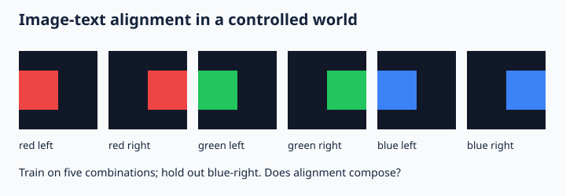

# Lecture 7 — Image-text representations: CLIP and SigLIP

[Course home](../../README.md) · Week 2, day 2 · 120 minutes · [Slides](../slides/07_contrastive.pptx) · [Notebook](../tutorials/07_contrastive.ipynb) · [Exercises](../exercises/07_contrastive.md) · [Quiz](../quizzes/07_contrastive.md)

## Learning outcomes

- Compute the symmetric contrastive loss and recall@k from a similarity matrix, by hand and in code.
- Explain what the temperature, in-batch negatives and the sigmoid loss each change.
- Use a frozen image encoder as a feature extractor, and test what it fails to represent.

## Session plan

| Minutes | Activity |
|---|---|
| 0–10 | Quiz 6 (multilingual and low-resource modelling) |
| 10–35 | Slides 1–13: the task images, dual encoders, patches, the similarity matrix, the 3×3 loss on the board, temperature, false negatives, SigLIP |
| 35–60 | Slides 14–23: SigLIP 2, zero-shot classification, recall@k, frozen features, the held-out combination, word order, Hausa and Yoruba captions, recall under a weaker text tower |
| 60–65 | Break |
| 65–105 | [Notebook 7](../tutorials/07_contrastive.ipynb): sections 1–5 together, section 6 in pairs |
| 105–115 | Slide 24: discuss why a multimodal run can score below a text-only run |
| 115–120 | Exit ticket: one measured number, one reason it may not transfer, the first image baseline for your task |

## Teaching notes

### What the tasks need
Three of the four capstone tasks have images. Task 12 has 1,658 paintings and asks for an emotion from painting and caption (subtask 1) or a sentiment share from the painting alone (subtask 3). Task 6 pairs a photo with a question. Task 9 subtask 2 labels the image of a news article with frames. Each system starts with an encoder that turns pixels into vectors. Today covers how that encoder is trained and how to use it frozen. Day 8 puts a text decoder after it.

### Two encoders, one comparison space
A dual encoder maps images through $f$ and text through $g$ to vectors of the same width. Normalise both before comparing: $u=f(I)/\|f(I)\|$, $v=g(t)/\|g(t)\|$, so that $u^\top v$ is a cosine. The encoders may have different architectures and share no weights; only the output width is shared (512 in CLIP ViT-B/32). Because each side is encoded alone, a million image vectors can be computed once and searched with any new caption.

### Patches
A vision transformer (Dosovitskiy et al., 2020) cuts the image into square patches, projects each to the model width, adds position embeddings and runs a transformer over the sequence. A 224-pixel image gives $7\times7=49$ tokens at patch size 32 and $14\times14=196$ at patch size 16. Halving the patch size multiplies the token count by four.

### The symmetric contrastive loss
For a batch of $N$ pairs the similarity matrix is $S_{ij}=u_i^\top v_j/\tau$, with temperature $\tau$. The image-to-text loss is $-N^{-1}\sum_i\log\frac{e^{S_{ii}}}{\sum_j e^{S_{ij}}}$. The text-to-image loss uses the columns. CLIP averages the two. The gradient with respect to $S$ is $(P^{\text{row}}-I+P^{\text{col}}-I)/2N$, where $P^{\text{row}}$ and $P^{\text{col}}$ are the row-wise and column-wise softmax of $S$. If every logit is equal the loss is $\log N$.

CLIP learns the temperature, starting at 0.07, and trained on 400 million pairs in batches of 32,768 (Radford et al., 2021). A cosine cannot exceed 1, so at $\tau=1$ the softmax barely separates a right caption from a nearly right one. For cosines 0.8, 0.6 and 0.1 the probability of the first is 0.43 at $\tau=1$, 0.72 at $\tau=0.2$ and 0.95 at $\tau=0.07$.

### False negatives
The other $N^2-N$ cells of the batch are treated as wrong. Some are right: two photos of one market may both match "a market". The loss pushes them apart. The problem grows with batch size and in narrow domains such as 1,658 paintings described with eight emotions. Remove duplicate captions from a batch, or mark several positives per row and average their log-probabilities. In evaluation, score against a set of relevant items.

### SigLIP and SigLIP 2
SigLIP (Zhai et al., 2023) replaces the batch softmax with one binary problem per cell: $L=-N^{-1}\sum_{i,j}\log\sigma\!\big(z_{ij}(t\,u_i^\top v_j+b)\big)$, with $z_{ij}=+1$ on the diagonal and $-1$ elsewhere. Nothing is normalised across the batch. Negatives outnumber positives by $N-1$ to 1, so the model learns a bias $b$, initialised at $-10$. The paper reports that the sigmoid loss does better than the softmax loss at small batch sizes.

SigLIP 2 (Tschannen et al., 2025) adds a captioning decoder loss and self-supervised losses to the sigmoid loss, trains on multilingual data and offers variants that keep the image's aspect ratio. Use the paper as an exercise in attribution: when loss, data and input change together, credit a gain to one component only where an ablation table supports it.

### Zero-shot classification and retrieval
To classify an image without training examples, encode one prompt per class, such as "a photograph of a bicycle", and pick the highest similarity. Prompt wording and the label set change the result, so choose them on development data. A softmax over the prompts you wrote sums to 1 by construction and is not a calibrated probability. For retrieval, report recall@k in both directions, the gallery size, the rule for several relevant items, and results on hard negatives. A random ranker scores $k/N$.

### A frozen encoder as a feature extractor
Run the image encoder once, save one vector per image, and fit a logistic regression on the vectors. The organisers' baseline for Task 12 subtask 3 is this recipe with CLIP ViT-B/32 features and reaches a within-painting correlation of 0.45. The same recipe is the first baseline for the frame labels of Task 9 subtask 2, with one classifier per frame. Features for 1,658 paintings at 512 numbers each take 3.4 MB, and no GPU is needed once they are saved.

### What the encoder does not learn
The loss asks only that the right caption beats the other captions in the batch. A model can meet that without reading word order, counts or relations (Yuksekgonul et al., 2022). Expect weak spots on "three goats" against "four goats", on "the cup on the book" against "the book on the cup", and on small text inside an image. Test them on your own data.

The lab makes the point with a held-out combination. The toy encoder is trained on five colour-position pairs and never sees blue-right. With seed 42 the blue-right image picks its own caption by 1.67 against 1.53, while every training image wins by more than 1, and the caption "blue right" retrieves the blue-left image. The pixels for blue-right had zero input throughout training, so their weights are still random. Over seeds 0 to 19 the image-to-text match is correct 3 times, which is chance for six captions.

### Captions in Hausa or Yoruba
CLIP's 400 million pairs were collected with queries built from English Wikipedia words. SigLIP 2 trains on multilingual data, as its title says; that does not say how well it embeds any one African language. Two checks take ten minutes. Tokenise a caption and count the pieces: try the Hausa word "shuɗi" (blue), which contains the hooked letter ɗ. Then take 50 image-caption pairs in English and in your language and compare recall@1. Yoruba web text is often written without tone marks, so test both spellings. The Task 12 baseline avoids the question by reading captions with XLM-R and paintings with a ViT.

## Worked example

Three images and three captions have these logits, already divided by the temperature.

| | Caption 1 | Caption 2 | Caption 3 | Row term |
|---|---|---|---|---|
| Image 1 | **3** | 1 | 0 | 0.170 |
| Image 2 | 1 | **2** | 3 | 1.408 |
| Image 3 | 0 | 1 | **4** | 0.066 |
| Column term | 0.170 | 0.551 | 0.327 | |

Row 2 is $\log(e+e^2+e^3)-2=\log 30.193-2=1.408$. The image-to-text mean is 0.548, the text-to-image mean is 0.349 and the loss is 0.449. Image 2 prefers caption 3, so image-to-text recall@1 is 2/3. Every caption ranks its own image first, so text-to-image recall@1 is 1. The sigmoid loss on the same matrix is 2.856 with $b=0$ and 1.213 with $b=-2$.

For $N=3$ and all logits zero, each row and column gives probability 1/3, and the loss is $\log 3=1.0986$.

## Guided tutorial

**Question:** Train a small image-to-text alignment model on generated pixel arrays, test a held-out colour-position combination, and reuse the frozen encoder for a new label.

The notebook builds six 8×8 images and hand-written label vectors, trains a 192×5 projection with the symmetric loss (2.54 at step 0, 0.076 at step 200), and prints the 6×6 similarity matrix. Students then check the 3×3 loss by hand, fit a logistic regression on frozen features (accuracy 1.000 on seen combinations), and write `contrastive_loss` and `recall_at_k` against tests. The data are generated and the text vectors are hand-written, so the results describe the toy.

**Real-model path:** `course/extensions/hf_vision.py --mode clip` loads a pretrained CLIP for retrieval on generated images. See the [extension guide](../extensions/README.md) for commands, hardware and validation status.

## Practical questions

1. Why normalise embeddings before comparing them?
2. Two captions in a batch are both correct for one image. What does the diagonal-only loss do, and what would you change?
3. A zero-shot classifier returns 0.9 for "a photo of a goat". Is that a probability that the image shows a goat?

## After class

Complete the [exercise sheet](../exercises/07_contrastive.md) in 45–60 minutes. Read sections 1 and 2 of the CLIP paper before the next session (20 minutes). [Quiz 7](../quizzes/07_contrastive.md) opens day 8.

## Readings

**Required**
- [Learning Transferable Visual Models From Natural Language Supervision](https://arxiv.org/abs/2103.00020) (Radford et al., 2021). Sections 1–2 and figure 1: the data, the loss and zero-shot classification.

**For teams with images**
- [Sigmoid Loss for Language Image Pre-Training](https://arxiv.org/abs/2303.15343) (Zhai et al., 2023). The loss in section 3 and the batch-size experiments.
- [SigLIP 2](https://arxiv.org/abs/2502.14786) (Tschannen et al., 2025). Find the ablation tables and decide which gains they support.
- [An Image is Worth 16x16 Words](https://arxiv.org/abs/2010.11929) (Dosovitskiy et al., 2020). Section 3.1 for patches and position embeddings.

**Going deeper**
- [When and why vision-language models behave like bags-of-words, and what to do about it?](https://arxiv.org/abs/2210.01936) (Yuksekgonul et al., 2022). Tests of word order and relations.
- [LiT: Zero-Shot Transfer with Locked-image text Tuning](https://arxiv.org/abs/2111.07991) (Zhai et al., 2021). Keeping the image encoder frozen and training only the text side.
