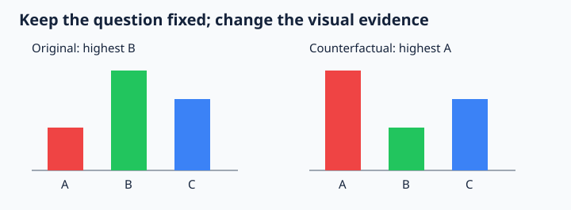

# Lecture 8 — Vision-language models

[Course home](../../README.md) · Week 2, day 3 · 120 minutes · [Slides](../slides/08_vlm.pptx) · [Notebook](../tutorials/08_vlm.ipynb) · [Exercises](../exercises/08_vlm.md) · [Quiz](../quizzes/08_vlm.md)

## Learning outcomes

- Explain how a vision encoder, a bridge and a language decoder are joined, and count the visual tokens an image costs.
- Test whether a system uses its image with blank, counterfactual and decoy images, and compute a one-sided exact McNemar p-value.
- Score visual answers on correctness, support and abstention.

## Session plan

| Minutes | Activity |
|---|---|
| 0–10 | Quiz 7 (CLIP and SigLIP) |
| 10–35 | Slides 1–12: the two task formats, encoder, bridge and decoder, the three bridge designs, the loss, patch counts, the processor, Gemma 3 and SmolVLM, documents |
| 35–60 | Slides 13–25: answering without looking, three interventions, the decoy test, McNemar on the board, three scores, the recorded SmolVLM error, BERTScore, safety of image inputs |
| 60–65 | Break |
| 65–105 | [Notebook 8](../tutorials/08_vlm.ipynb): sections 1–4 together, section 5 in pairs |
| 105–115 | Slide 26: discuss the 0.535 against 0.550 baseline result |
| 115–120 | Exit ticket: one number about image use, the first intervention for your system, one way to pass the decoy test and still be wrong |

## Teaching notes

### The task formats
Task 6 (MMCultureQA) gives an image and a question and asks for a short answer, ranked on BERTScore F1, with tracks for Swahili and Amharic. Task 12 subtask 1 gives a painting and a native-speaker caption and asks for one of eight emotions, ranked on macro-F1 averaged over languages. Both put an image and text in and take text out. Day 7 built the image encoder. Today adds a decoder and asks whether the decoder uses the image.

### Connecting vision to a language decoder
A common VLM joins a vision encoder, a bridge and a language decoder. The bridge maps visual features to the decoder's hidden width and decides how many of them reach the decoder. Visual features are inserted as tokens in the decoder's sequence or read through cross-attention. Training schedules differ across model families; a bridge-only alignment stage often comes before multimodal instruction tuning.

| | LLaVA | Flamingo | BLIP-2 |
|---|---|---|---|
| Bridge | Linear projection of patch features | Perceiver resampler and gated cross-attention layers | Q-Former with learned queries |
| What the LLM sees | Every patch, as tokens in its input | 64 visual vectors per image, through cross-attention | 32 query outputs, as tokens |
| Trained | Projection first, then projection and LLM | Resampler and cross-attention; encoder and LLM frozen | Q-Former; encoder and LLM frozen |
| Cost per image | Grows with resolution | Fixed | Fixed |

A projector keeps every patch and pays in sequence length. A resampler fixes the cost and may drop small detail.

The conditional objective is $-\sum_t\log p_\theta(y_t\mid y_{<t},x_{\text{text}},z_{\text{image}})$. As in text fine-tuning on day 4, mask the labels of the prompt, the image positions and the padding. Nothing in the loss forces the model to use $z_{\text{image}}$: when the question and the earlier answer tokens already predict the next token, little gradient flows through the image.

### Preprocessing and patch counts
Image preprocessing and token placement belong to the checkpoint's processor, and a text tokenizer cannot stand in for it. Resolution, cropping, aspect ratio and patch count set both the cost and what is lost. In the course's recorded SmolVLM-256M run, a 384×320 chart became 17 tiles of 512×512 pixels and an input of 1,156 tokens. Print the input shapes for your own model before planning a batch size.

### Documents require detail
A chart question may need four steps: find the axes, read the labels, find the mark, do the arithmetic. An OCR error early gives a fluent, wrong number at the end. Tables hold their meaning in the layout, and flattening one without its rows and columns can change it. For document questions, compare three paths: OCR then a text model, the image alone, and the image with the OCR text. Keep page IDs, bounding boxes where available, and the source evidence.

### Hallucination and interventions
A VLM can answer from a language prior when the image disagrees. Ask the same question with the original image, a blank image, a crop to the relevant region, a shuffled image and a counterfactual edit. If the answer stays the same when the evidence changes, either the question can be answered without vision or the model is ignoring the image. An intervention shows dependence on the image and does not explain the mechanism.

The lab makes the point with three rule-based systems on 300 chart questions where B is the tallest bar about half the time. `prior` always says B and scores 0.467 with the real image, 0.467 with a decoy, and answers B to a blank image. `weak` reads the chart on 15% of calls and scores 0.447 and 0.387. `parser` scores 1.000 and 0.333. On accuracy with the real image, the system that never looks beats the one that sometimes does.

### The decoy test in Task 12
Task 12 subtask 1 runs this intervention on every submission. Each test row has a decoy with the same caption and another painting. A multimodal run must do better with the right painting under a one-sided McNemar test at p < 0.05. A text-only run must give real and decoy rows the same label at least 99% of the time. The organisers' baseline, XLM-R and ViT features concatenated, scores macro-F1 0.535 multimodal against 0.550 text-only, so whether a system uses the painting is an open question for the baseline as well.

McNemar's test uses only the discordant rows. Let $b$ be the rows that are right with the real image and wrong with the decoy, and $c$ the reverse. If the image did not matter, each discordant row would fall either way with probability 1/2, and the exact one-sided p-value is $p=\sum_{k=b}^{b+c}\binom{b+c}{k}/2^{b+c}$. In the lab, `weak` has $b=76$ and $c=58$, which gives $p=0.071$: it does look at the image, and 300 questions are too few to show it. Check the organisers' scorer for the form of the test they use.

### Three scores
Use separate scores for correctness, support by the image, and abstention. In open-ended evaluation, match units and accept equivalent forms under a rule fixed before scoring. False-premise questions, such as "How tall is bar D?" on a chart with three bars, test whether the model invents evidence. Count errors, attribute errors, spatial-relation errors and reading errors need separate examples. Do not score every refusal as a success.

Task 6 is ranked on BERTScore F1 (Zhang et al., 2019). The metric embeds the tokens of the answer and of the reference with a pretrained encoder, matches each token to its most similar counterpart, and reports precision, recall and their F1. Extra words lower precision, so answer in a few words and in the language of the question. A wrong answer on the right topic still earns some score, so read a sample of outputs.

### Recent systems
Gemma 3 comes in 1B, 4B, 12B and 27B sizes. The 1B model is text-only; the larger ones take images through a SigLIP encoder at 896×896 and pass 256 tokens per image to the decoder. Do not assume every size in a family has the same inputs. SmolVLM comes in 256M, 500M and 2.2B sizes, and its paper reports that the 256M model runs in under 1 GB of GPU memory at inference.

The lab draws bar-chart pixels and reads them with a geometric parser, so students control the evidence and the ablations. The SmolVLM extension runs a pretrained VLM on the same kind of chart. A [recorded SmolVLM run](../validation/vlm_original_run.json) answered A on a [chart](../validation/vlm_original_chart.png) whose tallest bar was B, while the parser answers B. One example shows a failure and does not estimate quality. A small VLM need not beat a purpose-built chart reader, and the chart reader fails when the chart shifts 20 pixels.

### Safety of image inputs
An image is a second channel for instructions. FigStep embeds a harmful instruction in an image as typographic text to get past text-only safeguards, and MM-SafetyBench collects multimodal safety tests. Text-to-image models show a similar gap. PLACES (FAccT 2026) holds over 26,000 failures found by community red teaming with universities in Ghana, Nigeria, and two regions of India, and its authors describe existing safety frameworks as calibrated to a Western-centric default.

Use a benign proxy in class. Put an instruction such as "answer in one word" inside the image and the same instruction in the typed prompt, then compare compliance on the same 20 charts, with a no-instruction control. Do not create or share harmful prompts or images in this course. See the [safety thread](../SAFETY.md).

## Worked example

**Patch counts.** A 448×448 image with non-overlapping 14×14 patches has $32\times32=1024$ patch positions before pooling or special tokens. Doubling each side gives 4,096, four times as many. Pooling 4×4 neighbours turns 4,096 into 256. Real processors crop, tile and resample, so inspect their outputs.

**McNemar.** A system is scored on 100 rows with the real image and with a decoy.

| | Decoy right | Decoy wrong |
|---|---|---|
| Real right | 30 | 12 |
| Real wrong | 4 | 54 |

Accuracy is 42% with the real image and 34% with the decoy. The 16 discordant rows split 12 to 4. Then $p=\big(\binom{16}{12}+\binom{16}{13}+\binom{16}{14}+\binom{16}{15}+\binom{16}{16}\big)/2^{16}=(1820+560+120+16+1)/65536=0.038$, which passes at 0.05. A split of 6 to 2 gives $37/256=0.145$ and fails.

## Guided tutorial

**Question:** Draw chart pixels, read bar heights, and test with blank, counterfactual and decoy images whether a system uses what it is shown.

The notebook draws 64×96 charts, reads them with a fixed-layout parser, breaks the parser with a 20-pixel shift, and compares three systems with real and decoy images. Students then write `decoy_test`, which returns the discordant counts and the exact one-sided p-value, and `visual_tokens`. The systems are hand-written rules, and the results say nothing about a trained VLM.

**Real-model path:** `course/extensions/hf_vision.py --mode vlm` runs a pretrained VLM on a chart; inspect the image, prompt, processor output and answer together. See the [extension guide](../extensions/README.md) for commands, hardware and validation status.

## Practical questions

1. What does a blank-image baseline tell you that accuracy does not?
2. Can a correct numerical answer be visually ungrounded?
3. Why does the hand-written parser beat a small VLM on the lab's chart, and what breaks that advantage?

## After class

Complete the [exercise sheet](../exercises/08_vlm.md) in 45–60 minutes. Read sections 3 and 4 of the LLaVA paper before the next session (20 minutes). [Quiz 8](../quizzes/08_vlm.md) opens day 9.

## Readings

**Required**
- [Visual Instruction Tuning](https://arxiv.org/abs/2304.08485) (Liu et al., 2023). Sections 3–4: the projector and the two training stages.

**For Task 6 and Task 12 teams**
- [An Introduction to Vision-Language Modeling](https://arxiv.org/abs/2405.17247) (Bordes et al., 2024). A free primer; read it first if today's vocabulary is new.
- [Evaluating Object Hallucination in Large Vision-Language Models](https://arxiv.org/abs/2305.10355) (Li et al., 2023). A yes/no probe for objects that are absent from the image.
- [BERTScore](https://arxiv.org/abs/1904.09675) (Zhang et al., 2019). Section 3 defines the precision, recall and F1 that rank Task 6.
- [Multimodal chat templates](https://huggingface.co/docs/transformers/main/chat_template_multimodal). How a processor places image tokens in a prompt.

**Going deeper**
- [Flamingo](https://arxiv.org/abs/2204.14198) (Alayrac et al., 2022) and [BLIP-2](https://arxiv.org/abs/2301.12597) (Li et al., 2023). The cross-attention and Q-Former bridges.
- [Gemma 3 Technical Report](https://arxiv.org/abs/2503.19786) (2025). Read the vision section for the encoder and the token budget.
- [SmolVLM](https://arxiv.org/abs/2504.05299) (Marafioti et al., 2025). Design choices for small VLMs.
- [FigStep](https://arxiv.org/abs/2311.05608) (Gong et al., 2023), [MM-SafetyBench](https://arxiv.org/abs/2311.17600) (Liu et al., 2023) and [Going PLACES](https://arxiv.org/abs/2605.19190) (2026). The safety block.
