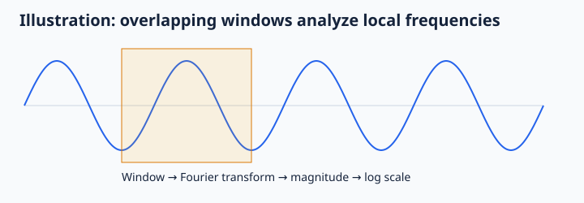

# Lecture 9 — Speech and multilingual ASR

[Course home](../../README.md) · Week 2, day 4 · 120 minutes · [Slides](../slides/09_speech.pptx) · [Notebook](../tutorials/09_speech.ipynb) · [Exercises](../exercises/09_speech.md) · [Quiz](../quizzes/09_speech.md)

## Learning outcomes

- Trace a waveform into time-frequency frames and say what the sample rate, window and hop each control.
- Apply the CTC collapse rule, and contrast CTC with encoder-decoder ASR and self-supervised pretraining.
- Compute WER and CER from an alignment, and plan an evaluation for a train-test shift in speakers.

## Session plan

| Minutes | Activity |
|---|---|
| 0–10 | Quiz 8 (vision-language models) |
| 10–35 | Slides 1–15: the Task 6 spoken question, sampling, STFT and mel features, the hidden alignment, CTC on the board, Whisper, wav2vec 2.0, choosing a family |
| 35–60 | Slides 16–24: WER by alignment, CER and normalisation, African-language ASR, the one-voice result, speaker splits and consent, cascade against end-to-end, the plan for human test audio |
| 60–65 | Break |
| 65–105 | [Notebook 9](../tutorials/09_speech.ipynb): sections 1–5 together, section 6 in pairs |
| 105–115 | Slide 25: how to compare a cascade with an end-to-end model |
| 115–120 | Exit ticket: one measured number, one way the toy differs from speech, cascade or end-to-end first |

## Teaching notes

### The task
Task 6 subtask 1 gives an image and a spoken question and asks for a short text answer, ranked on BERTScore F1. Tracks are open for Kiswahili and Amharic, and Afaan Oromo and Somali are announced. The spoken questions are synthetic in the training and development sets and human recordings in the test set. A team must choose between a cascade and an end-to-end model, and must plan for test audio that differs from its training audio.

### Audio is sampled evidence
A waveform is a sequence of amplitudes sampled at a rate such as 16 kHz, which can represent frequencies up to 8 kHz. Relabelling the sample rate is not resampling: it changes the duration and the pitch. In the lab, a one-second 440 Hz tone recorded at 48 kHz and read as 16 kHz lasts 3.0 seconds at 146.7 Hz. Convert channels deliberately and inspect clipping and silence.

The short-time Fourier transform applies a window to overlapping segments and computes the frequency content of each. With 400-sample frames (25 ms) every 160 samples (10 ms), one second gives 98 frames of 201 bins, 40 Hz apart. Mel filterbanks pool the frequency bins on a non-linear scale, and a log compresses the dynamic range. Whisper reads 80 mel channels at 100 frames per second in 30-second windows, which is 3,000 frames, halved to 1,500 encoder positions. The lab computes a log-magnitude STFT and has no mel step.

### Alignment is latent
Speech frames far outnumber output characters or subwords: a three-second question is 300 frames and perhaps 8 words. CTC sums the probabilities of all frame-level paths that collapse to the target, $p(y\mid x)=\sum_{\pi:\,\mathrm{collapse}(\pi)=y}\prod_t p_t(\pi_t)$. The collapse rule merges consecutive repeated labels and then removes blanks. A blank between repeated labels keeps both, which the Hausa greeting "sannu" needs for its two n's: `s s a _ n n _ n u u` gives "sannu" and `s s a n n n u u` gives "sanu". CTC predicts each frame independently given the encoder output and has no autoregressive language model of its own.

In the lab's four-frame example the best path has probability 0.168, while the 15 paths that collapse to "ab" total 0.604.

Encoder-decoder ASR attends from text outputs to audio representations and conditions on the tokens already written. Whisper (Radford et al., 2022) was trained with supervision on 680,000 hours of web audio with transcripts, 117,000 of them in 96 languages other than English. Its paper reports repeat loops and text unrelated to the audio among its failures on long recordings, and shows that the error rate for a language falls as its hours of training audio rise.

wav2vec 2.0 (Baevski et al., 2020) learns from untranscribed audio: it masks spans of latent frames and trains the model to pick the true latent among distractors, a contrastive task. Fine-tuning adds a linear layer trained with CTC. With 10 minutes of transcribed English and 53,000 hours of untranscribed audio it reaches WER 4.8 and 8.2 on the two LibriSpeech test sets. XLS-R pretrains the same model on speech in 128 languages. MMS builds one ASR model for 1,107 languages from readings of religious texts. Data, language exposure and decoding matter as much as the architecture label.

### Error metrics and normalisation
Word error rate is $(S+D+I)/N_{\text{ref}}$, where substitutions, deletions and insertions come from an edit alignment. WER exceeds 1 when insertions are many: reference "yes" and hypothesis "yes yes yes" give 2.0. Character error rate helps when word boundaries are ambiguous or words are long. In Swahili, "nakupenda" for "ninakupenda" (I love you) is a WER of 1.0 and a CER of 0.18.

Normalisation rules change the score. Lower-casing removes the error between "Habari ya asubuhi" and "habari ya asubuhi". Mapping the Hausa hooked ƙ to k would remove the error between "ƙofa" (door) and "kofa", and would hide a consonant the language distinguishes. Write the rules before scoring and report raw and normalised numbers when they differ.

A low WER does not guarantee correct names, negation or numbers. Add critical-token accuracy and error categories. Break results down by language and recording condition, with sample counts and uncertainty for small groups.

### African-language ASR
Four facts shape the work. Tone carries meaning: in Yoruba, ọkọ (husband) and ọkọ̀ (vehicle) differ in tone alone. Yoruba spelling marks tone, and standard Hausa spelling does not, so a Hausa transcript omits what the audio carries. Speakers mix languages inside a sentence, such as Swahili with English, while Whisper takes one language token per 30-second window. Transcribed audio is scarce: FLEURS has about 12 hours per language for 102 languages. And the easiest audio to collect is read speech from a few speakers, which differs from a question asked aloud. State your tone-mark policy, the language of each utterance, and the hours and speakers behind every number.

### Speakers, splits and shift
Split by speaker and by session so that near-identical acoustic conditions do not sit on both sides. The lab shows why with tones. Each of three "words" is a pair of tones and a "voice" scales the pitch. A nearest-mean recogniser trained on one voice scores 1.00 on that voice and 0.36 on new voices, where chance is 0.33. Trained on six voices it scores 0.69 and 0.50, because one mean per word cannot describe six voices. A feature that ignores the voice scores 1.00 on both. For Task 6 the development score on synthetic audio corresponds to the first number.

Use consented speech with documented access conditions. Transcribe only, and do not infer emotion, identity or sensitive attributes from voices.

### Cascade or end-to-end
A cascade runs ASR and then answers from the transcript and the image. Its errors accumulate and its latency adds across stages, and it gives a transcript to inspect. Unified audio-language models, which put a speech encoder in front of a language model as day 8 did with images (Qwen-Audio is one example), may keep prosody and timing that a transcript drops, and need evaluation on each language.

If the transcript is right for a share $p$ of questions, and the answer stage is right with probability $a$ after a right transcript and $e$ after a wrong one, the cascade answers $pa+(1-p)e$ correctly. A whole question of $L$ words survives a word error rate $w$ with probability $(1-w)^L$ if errors are independent: $0.95^8=0.66$.

For the shift in Task 6: record 30 to 50 development questions with consenting speakers; score the text system on the written question, the cascade and any end-to-end model on those recordings; measure WER and CER on synthetic and human audio; prefer an ASR model pretrained on human speech; and if you fine-tune on synthetic audio, vary speed and add noise and check the effect on the human set.

## Worked example

**WER.** Reference "the lab opens today"; hypothesis "lab opens on monday".

| Reference | the | lab | opens | | today |
|---|---|---|---|---|---|
| Hypothesis | | lab | opens | on | monday |
| Operation | D | ok | ok | I | S |

$D=1$, $I=1$, $S=1$, so WER $=3/4=0.75$. Other optimal alignments may distribute the operations differently; the total is fixed.

**CTC.** The path `a a _ a b b _` merges to `a _ a b _` and collapses to "aab". The path `a _ a _ b` collapses to "aab" as well.

**Cascade.** ASR transcribes 90% of questions correctly. The answer stage is right 60% of the time after a right transcript and 20% after a wrong one. The cascade answers $0.9\times0.6+0.1\times0.2=0.56$ of questions correctly. If human test audio lowers the ASR figure to 70%, the result is $0.7\times0.6+0.3\times0.2=0.48$.

## Guided tutorial

**Question:** Compute an STFT of a synthetic waveform, read a CTC output, score transcripts with WER and CER, and measure what a change of voice does to a recogniser.

The notebook computes the STFT of a 440 Hz tone, shows relabelling against resampling, prints a four-frame CTC output, aligns three transcript pairs, runs the one-voice experiment and the cascade arithmetic, and then asks students to write `ctc_collapse` and `cer` against tests. The audio is synthetic tones and the transcripts are hand-written. The lab transcribes no speech.

**Real-model path:** `course/extensions/hf_audio.py --audio path.wav` resamples a permitted short clip and runs a pretrained Whisper pipeline; score the output against a human transcript. See the [extension guide](../extensions/README.md) for commands, hardware and validation status.

## Practical questions

1. Why can WER exceed 100%?
2. What goes wrong when a 48 kHz recording is treated as 16 kHz without resampling?
3. Why should two clips from one speaker stay in the same split?

## After class

Complete the [exercise sheet](../exercises/09_speech.md) in 45–60 minutes. Read sections 1 and 2 of the Whisper paper and its limitations section before the next session (20 minutes). [Quiz 9](../quizzes/09_speech.md) opens day 10.

## Readings

**Required**
- [Robust Speech Recognition via Large-Scale Weak Supervision](https://arxiv.org/abs/2212.04356) (Radford et al., 2022). Sections 1–2 for the data and the model, and the limitations section for the failure modes.

**For Task 6 teams**
- [wav2vec 2.0](https://arxiv.org/abs/2006.11477) (Baevski et al., 2020). Sections 2–3: masking, the contrastive task and CTC fine-tuning.
- [Scaling Speech Technology to 1,000+ Languages](https://arxiv.org/abs/2305.13516) (Pratap et al., 2023). The MMS data and its comparison with Whisper on FLEURS.
- [FLEURS](https://arxiv.org/abs/2205.12446) (Conneau et al., 2022). A 102-language speech benchmark; check whether your language is in it.

**Going deeper**
- [Connectionist Temporal Classification](https://www.cs.toronto.edu/~graves/icml_2006.pdf) (Graves et al., 2006). The forward algorithm behind the path sum.
- [XLS-R](https://arxiv.org/abs/2111.09296) (Babu et al., 2021). Cross-lingual self-supervised pretraining in 128 languages.
- [Qwen-Audio](https://arxiv.org/abs/2311.07919) (Chu et al., 2023). One audio-language model design.
- [Common Voice](https://arxiv.org/abs/1912.06670) (Ardila et al., 2019). Crowdsourced, consented speech collection and validation.
